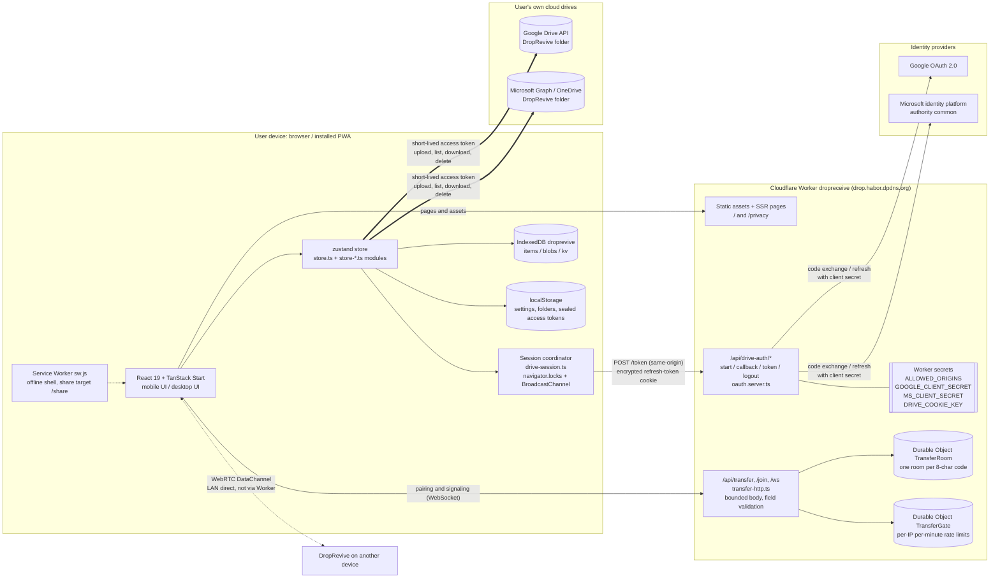
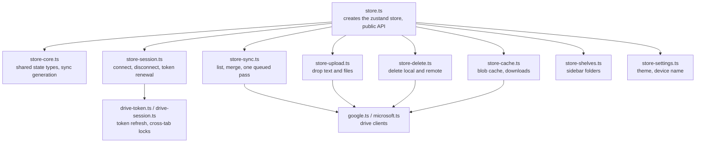
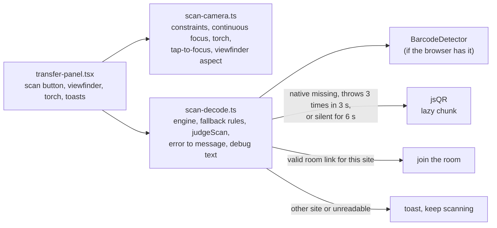

# DropRevive architecture

[中文](architecture.zh-CN.md)

Describes the code on `main` when this document was last refreshed; the live source is whatever the `production` tag points at, and the code wins over this text if they disagree. Diagrams are Mermaid and render on GitHub. Diagram labels are English in both language editions.

## 1. Component overview



Key points:

- File and text bytes flow in only two places: between the browser and the user's own drive (cloud drop), or between two devices (LAN transfer). The Worker does not proxy drive calls and does not forward transfer payloads.
- The Worker does three things: serve pages; exchange tokens with Google / Microsoft for the browser (the client-secret step); and LAN pairing / signaling.
- There is no database. Sign-in state is an encrypted cookie in the browser. Durable Objects hold only transfer rooms (code, both sides' random tokens and device names; expire after 10 minutes unpaired, session max 2 hours) and one-minute rate-limit counters.
- LAN `RTCPeerConnection` uses `iceServers: []` — no STUN, no TURN — so peers must be able to reach each other directly (same LAN). Guest Wi-Fi isolation, VPN, and cellular fail; the UI steers users to cloud drop.
- `npm run dev` (Vite) has no Durable Objects; `/api/transfer` returns 404. Try LAN transfer only on a deployed Worker (with `ALLOWED_ORIGINS` unset it works on the Worker's own origin; when set, it must list that origin).

## 2. Sign-in and refresh

```mermaid
sequenceDiagram
  autonumber
  participant B as Browser tab
  participant O as Other same-origin tab
  participant W as Worker /api/drive-auth
  participant P as Google or Microsoft
  participant D as Drive API or Graph

  Note over B,P: Connect drive (auth code + PKCE)
  B->>W: GET /{p}/start?hint=account
  W->>W: Create state + PKCE verifier, AES-GCM into __Secure-dr-oauth cookie (10 min)
  W-->>B: 302 to authorize (redirect_uri = site /api/drive-auth/{p}/callback, code_challenge S256)
  B->>P: User signs in and consents
  P-->>B: 302 back /{p}/callback?code&state
  B->>W: GET /{p}/callback (with state cookie)
  W->>W: Check state vs cookie; on mismatch return home with state_mismatch
  W->>P: Exchange code + verifier + client secret for tokens
  P-->>W: access token + refresh token
  W-->>B: 302 to /?connected={p}, Set-Cookie __Secure-dr-g or dr-m (AES-GCM refresh token, HttpOnly, SameSite=Lax, Path=/api/drive-auth)

  Note over B,D: Day-to-day use
  B->>D: Call Drive / Graph directly (Authorization: Bearer access token)
  Note over B: Sync skips Worker while access token has >5 min left

  Note over B,P: Refresh (near expiry or drive returns 401)
  B->>B: navigator.locks droprevive-drive-auth:{p}; other tabs queue
  O-->>B: Token previously broadcast on droprevive-drive-auth, cached on this tab
  alt Shared token obtained within 2 min and >5 min left
    B->>B: Use it; no request
  else Need Worker
    B->>W: POST /token (same-origin only: Origin and Sec-Fetch-Site)
    W->>W: Unwrap refresh-token cookie
    W->>P: grant_type=refresh_token + client secret
    alt Success
      P-->>W: New access token (Microsoft also rotates refresh token)
      W-->>B: { access_token, expires_in }, rewrite refresh-token cookie
      B-->>O: BroadcastChannel new token
    else invalid_grant (another tab may have rotated Microsoft refresh token)
      W-->>B: { error: stale_grant }, cookie kept
      B->>B: Wait 1 s
      B->>W: POST /token?final=1 (browser sends latest cookie)
      W-->>B: New token, or reauth_required (clear cookie; UI asks reconnect)
    end
  end

  Note over B,W: Disconnect
  B->>W: POST /logout?p={p} (same-origin)
  W-->>B: Clear this device's cookie for that drive
```

Notes:

- Allowed origins come from the optional Worker secret `ALLOWED_ORIGINS` (comma-separated full origins). Unset, empty or `none`: same-origin only (a request's origin must equal the request URL's origin, which covers workers.dev and any custom domain). Set: a strict list. Only malformed entries: everything refused (fail closed). `http://localhost:8080` stays open for local `npm run dev`. A drive is on only when its client ID, client secret and a 32-byte `DRIVE_COOKIE_KEY` are set; otherwise its endpoints answer `not_configured`. `redirect_uri` uses the request's own origin, so each deployment returns to its own host.
- On `http://localhost`, cookies omit the `__Secure-` prefix and the `Secure` flag.
- Provider errors on the callback are mapped to fixed copy; the provider's raw text is not returned to the page.
- "Disconnect" clears only this device's cookie; it does not revoke at the provider. To revoke everywhere, use Google / Microsoft account permissions (links on `/privacy`).
- Before 2026-10-02 production used in-browser sign-in (GIS / MSAL). Those sessions lack `via: "server"`; the new build drops them and clears old MSAL cache, so users must reconnect once.

## 3. What lives where

| Location | Contents | Who can read |
| --- | --- | --- |
| User's Google Drive / OneDrive, `DropRevive` folder and subfolders | Dropped content. Each item has JSON metadata (type, time, source device id/name, filename, size; text inline); files stored separately. Sidebar folders are subfolders here | The user; the app with an access token |
| Browser cookies `__Secure-dr-g`, `__Secure-dr-m` | AES-GCM-wrapped refresh tokens; key is Worker secret `DRIVE_COOKIE_KEY`; sent only to `/api/drive-auth` | Worker only; page scripts cannot read (HttpOnly) |
| Browser cookie `__Secure-dr-oauth` | In-flight state and PKCE verifier, 10 minutes | Worker only |
| localStorage `droprevive.tokens` | Access tokens (~1 hour), sealed with a non-exportable AES-GCM key in IndexedDB | Same-origin page scripts |
| localStorage `droprevive.settings`, `droprevive.folders`, `droprevive.shelves`, `droprevive.locale`, `droprevive.outbox` | Theme and device name, drive folder IDs, sidebar folders, UI locale, cloud refs not yet deleted | Same-origin page scripts |
| IndexedDB `droprevive`: `items`, `blobs`, `kv` | History cache, file cache, the seal key above | Same-origin page scripts |
| Cache Storage (Service Worker) | Offline shell; system-share payload staged in `droprevive-share` until the app opens | This origin |
| Durable Object `TransferRoom` | Transfer room: code, both random tokens, device names, phase; deleted on expiry | Worker only |
| Durable Object `TransferGate` | `create:IP` / `join:IP` one-minute window counters; deleted when stale | Worker only |
| Worker secrets | `ALLOWED_ORIGINS`, `GOOGLE_CLIENT_SECRET`, `MS_CLIENT_SECRET`, `DRIVE_COOKIE_KEY` | Worker only; not in the frontend bundle or `wrangler.jsonc` `vars`. `/setup` shows only whether each is set and its source. Optionally from Cloudflare Secrets Store instead: bindings `SS_<KEY>` (added at build when `DROP_SECRETS_STORE_ID` is set) are read first, cached about 60 s per isolate; see `resolveConfigEnv` in `src/lib/runtime-config.ts` |
| Worker secrets (public values) | `GOOGLE_CLIENT_ID`, `MS_CLIENT_ID` | Sent to the page during SSR (root loader) and by `GET /api/config`; fall back to build-time `VITE_*` IDs |

Clearing local cache removes only the browser rows above; drive files remain. Deleting an item in the app removes the matching drive files.

## 4. Where the code is

| Path | Role |
| --- | --- |
| `src/routes/index.tsx`, `src/components/drop/` | Main UI: mobile (`drop-app.tsx`) and desktop (`desktop-shell.tsx`), timeline, composer, settings, transfer panel |
| `src/routes/privacy.tsx` | Privacy notice (Chinese and English) |
| `src/routes/api/drive-auth/$.ts` → `src/lib/drop/oauth.server.ts` | Sign-in broker |
| `src/lib/drop/drive-session.ts`, `drive-token.ts` | Browser-side refresh and cross-tab coordination |
| `src/lib/drop/store.ts` and `store-*.ts` (see section 5), `google.ts`, `microsoft.ts`, `reconcile.ts` | Sync, upload, download, delete, reconcile |
| `server/routes/api/transfer*.ts`, `server/transfer-*.ts`, `exports.cloudflare.ts` | Transfer HTTP / WebSocket entry and two Durable Objects |
| `src/lib/transfer/` | Transfer protocol, chunking, limits (`limits.ts`), reconnect; scanner helpers `scan-camera.ts` and `scan-decode.ts` (section 6) |
| `src/lib/links.ts`, `src/components/drop/telegram-icon.tsx` | The Telegram group URL (also in `SECURITY.md`; a test keeps them equal) and the logo used on the privacy page and next to Settings |
| `scripts/deploy-self.mjs`, `scripts/deploy-staging.mjs`, `.github/workflows/ci.yml` | Guarded self-host deploy, staging deploy, CI |
| `scripts/wrangler-profile.mjs`, `scripts/check-profile.mjs` | Public vs production Worker profile (`DROP_PROFILE`), post-build config check |
| `src/routes/setup.tsx`, `src/lib/setup-status.ts`, `src/lib/runtime-config.ts`, `src/lib/server-config.ts` | `/setup` self-check, Worker settings read at request time |
| `public/sw.js`, `public/manifest.webmanifest`, `public/icons/` | Service Worker, PWA manifest (incl. share target), icons |

## 5. Drive store modules

`src/lib/drop/store.ts` creates the zustand store and keeps the public API; the work is split by responsibility into modules that take the store's `get` / `set`. Components import only `store.ts`.



Sync requests that arrive during a run share it and queue exactly one more pass. A listing that fails part-way never wipes existing local history. The store has unit tests (`store.test.ts`, `store.sync.test.ts`) built on fake drive clients (`store.test-fakes.ts`).

## 6. LAN transfer: HTTP entry and the in-page scanner

`server/transfer-http.ts` is the only HTTP entry for LAN pairing. It checks the request origin (same host as the request, then `ALLOWED_ORIGINS` or, when unset, same-origin), rejects a declared `Content-Length` over the cap before reading, reads the body as a stream and cancels it once it passes the cap (so chunked or under-declared bodies are never buffered whole), and validates the parsed JSON: it must be a plain object, `deviceName` and `code` must be strings of the allowed shape, and unknown extra keys are ignored. Oversized requests get 413, malformed ones 400, and nothing in this path should produce a 500.



Notes:

- Camera setup asks for 1280x720 at 30 fps (`facingMode: environment`), applies continuous focus when the track reports it, and exposes the torch only when the capability exists. The viewfinder box takes its aspect ratio from the feed, clamped to a range, with `object-cover`; tap-to-focus maps the tap back through the crop (`tapPoint`).
- Decoding always reads the full frame (downscaled to 640 px wide for jsQR), not only the visible crop.
- `BarcodeDetector` can exist and still fail, for example in Android browsers without Google services; that is why the fallback also triggers on repeated errors and on a silent native decoder, not only when the API is missing. iOS Safari has no `BarcodeDetector` at all and always uses jsQR.
- `?scandebug=1` shows a diagnostic overlay (decoder, formats, camera capabilities, last error and result). It is hidden by default.
- User-facing failures (permission denied, no camera, other site's code, nothing read after 10 s) are toasts or the panel's normal notice area, never text over the picture.

## 7. LAN session lifecycle

The session is owned by the tab, not by the panel. `src/lib/transfer/lan-session.ts` (a zustand store, created once per tab in `src/components/drop/lan-session-store.ts`) owns the room, the WebRTC link (`link.ts`), the timeline and the received files. `transfer-panel.tsx` only subscribes and calls actions; unmounting it closes the camera, nothing else. `lan-badge.tsx` shows the nav badge; toasts with an Open action stand in for the panel while it is closed. Pure helpers (timeline cap, unsaved totals, badge, visibility nudge) are in `session-state.ts`.

| Event | What happens |
| --- | --- |
| 断开 | Confirm first if received files are unsaved. Send `{"t":"bye"}` on the data channel, then `cancel` to the room; the server closes both sockets with `peer-left` (`reason: "bye"`). Back to the start screen; everything is cleared |
| Tab closed (`pagehide`) | Same bye + cancel, then the link is disposed. `beforeunload` asks only while sending/receiving or holding unsaved files |
| Peer bye (data channel or `peer-left` `bye`) | Session cleared; unsaved files stay with their batch, plus a notice |
| Drop without bye | 重连中; recovery as before (ICE restart, socket reconnect with 1 s → 30 s backoff). On `visibilitychange` to visible, `link.nudge()` reports a dropped socket/channel/peer so recovery starts at once |
| No recovery within `RECONNECT_GRACE_MS` (10 min) | The client gives up, or the server alarm sends `peer-left` (`reason: "gone"`) to the side still connected. Session cleared, unsaved files kept, notice |
| Server idle / hard expiry | As before (`ROOM_TTL_MS` 10 min idle, `MAX_SESSION_MS` 2 h). When a paired side drops, `markAbsent` pushes the room's expiry to at least the reconnect window plus 1 min (capped by the hard limit), so idle expiry cannot end the room first |

Memory: received files are held as bytes in the store until saved or removed (移除); thumbnails (Blob URLs) are revoked on save, on remove and when the session ends; a warning fires once when unsaved bytes cross 128 MiB (`UNSAVED_WARN_BYTES`); the timeline keeps at most 200 entries (`MAX_TIMELINE`), never dropping open batches or ones with unsaved files.

Limit: mobile browsers may freeze a background tab and drop its WebRTC link. Within the reconnect window it recovers when the tab is visible again; the OS can also kill the tab, which ends the session without a bye (the peer then waits out the window).
