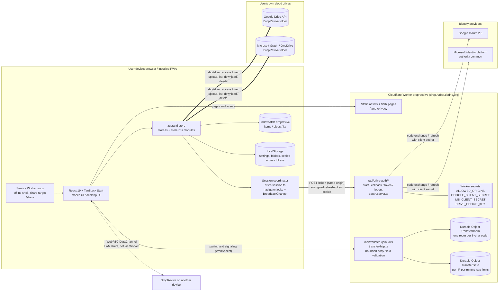
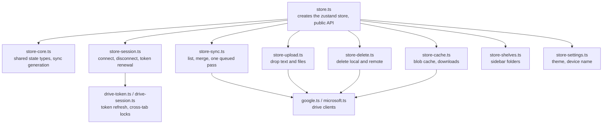
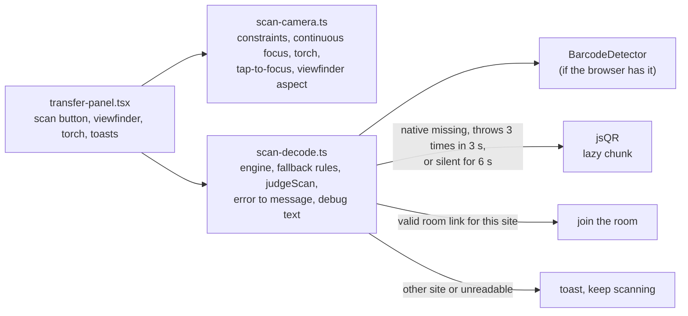

# DropRevive 架构

[English](architecture.md)

本文描述最近一次更新文档时 `main` 上的代码；线上源码以 `production` 标签所指为准，文档与代码不一致时以代码为准。图用 Mermaid，GitHub 会直接渲染。两份语言版共用同一套**英文**图标注。

## 1. 组件总览



要点：

- 文件和文字的字节只在两处流动：浏览器和用户自己的网盘之间（云端投送），或者两台设备之间（局域网直传）。Worker 不代理网盘请求，也不转发直传的字节。
- Worker 只做三件事：发页面；替浏览器向 Google / Microsoft 换令牌（需要 client secret 的那一步）；局域网直传的配对和信令。
- 没有数据库。登录状态是浏览器里的加密 cookie。Durable Object 只放直传房间（代码、两端的随机令牌和设备名，10 分钟没配上就过期，会话最长 2 小时）和一分钟窗口的限流计数。
- 局域网直传的 `RTCPeerConnection` 用 `iceServers: []`，不用 STUN，也不用 TURN，所以只在两台设备能直接互通时连得上（同一个局域网）。访客网络隔离、VPN、蜂窝网会失败，界面会让用户改用云端。
- `npm run dev`（Vite）里没有 Durable Object，`/api/transfer` 返回 404；直传只能在部署后的 Worker 上试，且该 Worker 的 `ALLOWED_ORIGINS` 密钥须包含该站点的 origin。

## 2. 登录和续签

```mermaid
sequenceDiagram
  autonumber
  participant B as Browser tab
  participant O as Other same-origin tab
  participant W as Worker /api/drive-auth
  participant P as Google or Microsoft
  participant D as Drive API or Graph

  Note over B,P: Connect drive (auth code + PKCE)
  B->>W: GET /{p}/start?hint=account
  W->>W: Create state + PKCE verifier, AES-GCM into __Secure-dr-oauth cookie (10 min)
  W-->>B: 302 to authorize (redirect_uri = site /api/drive-auth/{p}/callback, code_challenge S256)
  B->>P: User signs in and consents
  P-->>B: 302 back /{p}/callback?code&state
  B->>W: GET /{p}/callback (with state cookie)
  W->>W: Check state vs cookie; on mismatch return home with state_mismatch
  W->>P: Exchange code + verifier + client secret for tokens
  P-->>W: access token + refresh token
  W-->>B: 302 to /?connected={p}, Set-Cookie __Secure-dr-g or dr-m (AES-GCM refresh token, HttpOnly, SameSite=Lax, Path=/api/drive-auth)

  Note over B,D: Day-to-day use
  B->>D: Call Drive / Graph directly (Authorization: Bearer access token)
  Note over B: Sync skips Worker while access token has >5 min left

  Note over B,P: Refresh (near expiry or drive returns 401)
  B->>B: navigator.locks droprevive-drive-auth:{p}; other tabs queue
  O-->>B: Token previously broadcast on droprevive-drive-auth, cached on this tab
  alt Shared token obtained within 2 min and >5 min left
    B->>B: Use it; no request
  else Need Worker
    B->>W: POST /token (same-origin only: Origin and Sec-Fetch-Site)
    W->>W: Unwrap refresh-token cookie
    W->>P: grant_type=refresh_token + client secret
    alt Success
      P-->>W: New access token (Microsoft also rotates refresh token)
      W-->>B: { access_token, expires_in }, rewrite refresh-token cookie
      B-->>O: BroadcastChannel new token
    else invalid_grant (another tab may have rotated Microsoft refresh token)
      W-->>B: { error: stale_grant }, cookie kept
      B->>B: Wait 1 s
      B->>W: POST /token?final=1 (browser sends latest cookie)
      W-->>B: New token, or reauth_required (clear cookie; UI asks reconnect)
    end
  end

  Note over B,W: Disconnect
  B->>W: POST /logout?p={p} (same-origin)
  W-->>B: Clear this device's cookie for that drive
```

说明：

- 允许的来源来自 Worker 密钥 `ALLOWED_ORIGINS`（逗号分隔的完整 origin）。缺失或为空时拒绝已部署的主机；`http://localhost:8080` 仍对本机 `npm run dev` 放行。`redirect_uri` 用的是请求本身的来源，所以每个部署各自回到自己的域名。
- `http://localhost` 上 cookie 不加 `__Secure-` 前缀，也不加 `Secure`。
- 回调里服务商返回的错误只换成固定的中文说明，不把对方的原文带回页面。
- 「断开」只清这台设备的 cookie，不会去服务商那边撤销授权。要让所有设备都失效，到 Google / Microsoft 的账号权限页撤销（`/privacy` 里有链接）。
- 2026-10-02 之前生产用的是浏览器内登录（GIS / MSAL）。那种会话没有 `via: "server"` 标记，新版本加载时会丢掉并清理旧的 MSAL 缓存，用户需要重新连接一次。

## 3. 什么存在哪里

| 位置 | 内容 | 谁能读 |
| --- | --- | --- |
| 用户的 Google Drive / OneDrive，`DropRevive` 文件夹及其子文件夹 | 投送的内容。每条记录一份 JSON 元数据（类型、时间、来源设备 ID 和设备名、文件名、大小；文字直接写在里面），文件另存一份。侧边栏里的文件夹就是这里的子文件夹 | 用户本人；应用凭访问令牌读写 |
| 浏览器 cookie `__Secure-dr-g`、`__Secure-dr-m` | AES-GCM 封装的刷新令牌，密钥是 Worker 密钥 `DRIVE_COOKIE_KEY`，只发给 `/api/drive-auth` | 只有 Worker 能解开；页面脚本读不到（HttpOnly） |
| 浏览器 cookie `__Secure-dr-oauth` | 登录途中的 state 和 PKCE verifier，10 分钟 | 只有 Worker |
| localStorage `droprevive.tokens` | 访问令牌（约 1 小时），用 IndexedDB 里一把不可导出的 AES-GCM 密钥封装 | 本站页面脚本 |
| localStorage `droprevive.settings`、`droprevive.folders`、`droprevive.shelves`、`droprevive.locale`、`droprevive.outbox` | 主题和设备名、网盘上的目录 ID、侧边栏文件夹、界面语言、还没删掉的云端引用 | 本站页面脚本 |
| IndexedDB `droprevive`：`items`、`blobs`、`kv` | 历史缓存、文件缓存、上面那把密钥 | 本站页面脚本 |
| Cache Storage（Service Worker） | 离线外壳；系统分享进来的内容暂存在 `droprevive-share`，打开应用后取走 | 本站 |
| Durable Object `TransferRoom` | 直传房间：代码、两端随机令牌、设备名、阶段；过期删除 | 只有 Worker |
| Durable Object `TransferGate` | `create:IP` / `join:IP` 一分钟窗口的计数，过期删除 | 只有 Worker |
| Worker 密钥 | `ALLOWED_ORIGINS`、`GOOGLE_CLIENT_SECRET`、`MS_CLIENT_SECRET`、`DRIVE_COOKIE_KEY` | 只有 Worker；不进前端包，也不写进 `wrangler.jsonc` 的 `vars` |

清除本机缓存只删上面浏览器里的部分，网盘里的文件还在。在应用里删除一条记录，才会把网盘里的对应文件删掉。

## 4. 代码在哪

| 路径 | 作用 |
| --- | --- |
| `src/routes/index.tsx`、`src/components/drop/` | 主界面：手机（`drop-app.tsx`）和桌面（`desktop-shell.tsx`）、时间线、输入框、设置、直传面板 |
| `src/routes/privacy.tsx` | 隐私说明（中英文） |
| `src/routes/api/drive-auth/$.ts` → `src/lib/drop/oauth.server.ts` | 登录经纪 |
| `src/lib/drop/drive-session.ts`、`drive-token.ts` | 浏览器端续签、跨标签页协调 |
| `src/lib/drop/store.ts` 和 `store-*.ts`（见第 5 节）、`google.ts`、`microsoft.ts`、`reconcile.ts` | 同步、上传、下载、删除、对账 |
| `server/routes/api/transfer*.ts`、`server/transfer-*.ts`、`exports.cloudflare.ts` | 直传的 HTTP / WebSocket 入口和两个 Durable Object |
| `src/lib/transfer/` | 直传协议、分块、限额（`limits.ts`）、重连；扫码辅助 `scan-camera.ts`、`scan-decode.ts`（第 6 节） |
| `src/lib/links.ts`、`src/components/drop/telegram-icon.tsx` | Telegram 群组地址（`SECURITY.md` 里也有，由测试保证两处一致）和用在隐私页、设置旁边的 logo |
| `scripts/deploy-self.mjs`、`scripts/deploy-staging.mjs`、`.github/workflows/ci.yml` | 带保护的自建部署、测试站部署、CI |
| `public/sw.js`、`public/manifest.webmanifest`、`public/icons/` | Service Worker、PWA 清单（含分享目标）、图标 |

## 5. 网盘 store 的模块

`src/lib/drop/store.ts` 创建 zustand store 并保持对外 API 不变；具体工作按职责拆到几个接收 store 的 `get` / `set` 的模块里。组件只引用 `store.ts`。



同步运行期间到来的同步请求会共用这一轮，并且只再排一轮。列表中途失败不会清掉已有的本地历史。store 有单元测试（`store.test.ts`、`store.sync.test.ts`），用假的网盘客户端（`store.test-fakes.ts`）。

## 6. 局域网直传：HTTP 入口和页面内扫码器

`server/transfer-http.ts` 是局域网配对唯一的 HTTP 入口。它按 `ALLOWED_ORIGINS` 检查请求来源；声明的 `Content-Length` 超过上限时，读取前就拒绝；请求体按流读取，超过上限立即取消（分块或少报长度的请求体不会被整个缓冲）；解析出的 JSON 还要校验：必须是普通对象，`deviceName` 和 `code` 必须是符合格式的字符串，多余的未知字段忽略。超大请求返回 413，格式不对返回 400，这条路径不应出现 500。



说明：

- 摄像头请求 1280x720、30 帧（`facingMode: environment`），轨道支持时启用连续对焦，只有摄像头具备能力时才显示手电筒。取景框的宽高比取自画面并限制在一个范围内，使用 `object-cover`；点击对焦通过 `tapPoint` 把点击位置还原到被裁剪前的画面坐标。
- 解码始终读整帧（给 jsQR 的帧缩到 640 px 宽），而不是只看可见的裁剪部分。
- `BarcodeDetector` 可能存在却读不出来，例如没有 Google 服务的安卓浏览器；所以兜底不只在 API 缺失时触发，原生解码器连续报错、或长时间没有任何输出时也会切到 jsQR。iOS Safari 根本没有 `BarcodeDetector`，一直用 jsQR。
- `?scandebug=1` 会显示诊断浮层（解码器、支持的格式、摄像头能力、最近的错误和结果），默认隐藏。
- 面向用户的失败提示（没给权限、没有摄像头、别的站点的码、10 秒什么都没读到）用 toast 或面板原有的提示区域，不会在画面上盖文字。
